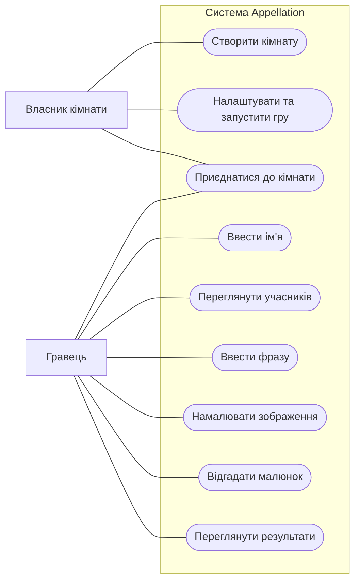

# Діаграма варіантів використання Appellation

## 1. Призначення

Діаграма варіантів використання показує взаємодію гравців із системою Appellation. Користувачі можуть створювати ігрові кімнати, приєднуватися до інших гравців, малювати зображення та відгадувати слова.

## 2. Учасники системи

- **Гравець** — створює кімнату, приєднується до гри, вводить фрази, малює та відгадує зображення.
- **Власник кімнати** — створює кімнату, налаштовує гру та запускає ігровий процес.

## 3. UML Use Case Diagram

## 4. Опис основних сценаріїв

### Сценарій 1. Створення ігрової кімнати

**Мета:** створити кімнату для спільної гри з іншими користувачами.

**Передумови:**
- Користувач відкрив застосунок Appellation.
- Користувач має доступ до інтернету.

**Основний потік:**
1. Користувач натискає кнопку «Створити кімнату».
2. Система створює нову ігрову кімнату.
3. Система генерує унікальний код кімнати.
4. Користувач отримує посилання або код для запрошення друзів.
5. Інші гравці приєднуються до кімнати.

**Альтернативи:**
- Якщо немає підключення до інтернету, система показує повідомлення про помилку.
- Якщо створити кімнату не вдалося, система пропонує повторити спробу.

### Сценарій 2. Проходження ігрового раунду

**Мета:** створити малюнок на основі отриманої фрази.

**Передумови:**
- Гравець приєднався до кімнати.
- Гра була запущена.
- Гравець отримав фразу для малювання.

**Основний потік:**
1. Система показує гравцю отриману фразу.
2. Гравець читає фразу.
3. Гравець малює зображення на полотні.
4. Гравець підтверджує готовність малюнка.
5. Система зберігає результат.
6. Малюнок передається наступному гравцю для відгадування.

**Альтернативи:**
- Якщо час вичерпано, система автоматично завершує раунд.
- Якщо гравець не підтвердив малюнок, система завершує раунд після закінчення таймера.

### Сценарій 3. Відгадування малюнка

**Мета:** відгадати фразу або слово за отриманим зображенням.

**Передумови:**
- Гравець приєднався до ігрової кімнати.
- Гравець отримав малюнок від іншого учасника.
- Раунд перебуває в процесі виконання.

**Основний потік:**
1. Система показує гравцю малюнок.
2. Гравець переглядає зображення.
3. Гравець вводить свою відповідь.
4. Система зберігає відповідь.
5. Система передає результат наступному учаснику.
6. Після завершення гри система показує результати.

**Альтернативи:**
- Якщо гравець не ввів відповідь вчасно, система завершує раунд.
- Якщо відповідь порожня, система пропонує ввести її повторно.

## 5. Висновок

Було визначено основних учасників системи Appellation та створено діаграму варіантів використання. Описано три основні сценарії: створення кімнати, проходження ігрового раунду та відгадування малюнка з урахуванням передумов, основних потоків і альтернативних ситуацій.
