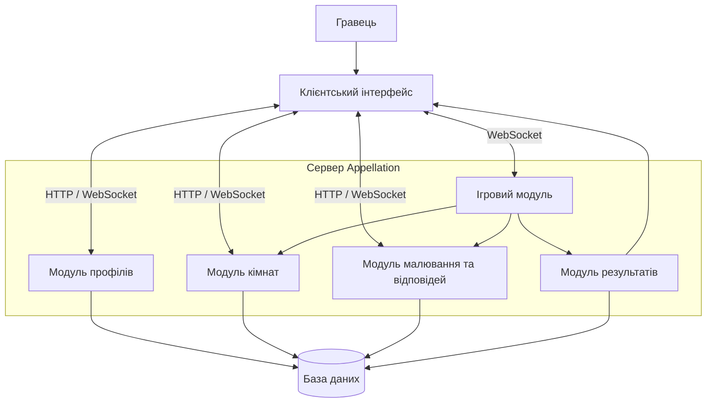

# Архітектура системи Appellation

## 1. Загальний опис

Appellation — це багатокористувацька онлайн-гра, у якій гравці створюють кімнати, приєднуються до інших учасників, вводять фрази, малюють зображення та відгадують малюнки.

Для розробки системи обрано клієнт-серверну архітектуру з багаторівневою структурою.

## 2. Архітектурний стиль

**Клієнт-серверна архітектура** передбачає взаємодію між клієнтською частиною та сервером.

- **Клієнтська частина** — відображає інтерфейс гри, кімнати, малюнки та результати.
- **Серверна частина** — обробляє запити, керує ігровими кімнатами, раундами та взаємодією між гравцями.
- **База даних** — зберігає інформацію про користувачів, кімнати, ігри та результати.

### Чому обрано цей стиль?

Клієнт-серверна архітектура підходить для Appellation, оскільки гра передбачає одночасну участь декількох користувачів. Сервер забезпечує обмін даними між гравцями та синхронізацію ігрового процесу.

Така архітектура також дозволяє оновлювати клієнтську та серверну частини окремо.

## 3. Структура системи

Система складається з таких основних компонентів:

1. **Інтерфейс користувача** — відображення екранів гри та взаємодія з гравцями.
2. **Модуль авторизації та профілів** — робота з іменами та профілями гравців.
3. **Модуль ігрових кімнат** — створення кімнат і підключення учасників.
4. **Ігровий модуль** — керування раундами, таймером і правилами гри.
5. **Модуль малювання та відповідей** — створення малюнків і введення відповідей.
6. **Модуль результатів** — підрахунок балів і відображення результатів.
7. **База даних** — зберігання необхідної інформації.

## 4. Діаграма компонентів

## 5. Масштабування системи

У майбутньому Appellation можна розширювати за допомогою таких можливостей:

- Збільшення потужності сервера для підтримки більшої кількості гравців.
- Додавання нових ігрових режимів.
- Створення більшої кількості ігрових кімнат.
- Оптимізація бази даних для швидшого оброблення запитів.
- Використання декількох серверів для розподілу навантаження.

## 6. Можливості розширення

У майбутньому до системи можна додати:

- Реєстрацію та авторизацію користувачів.
- Систему друзів і запрошень.
- Нові інструменти для малювання.
- Рейтинг гравців і таблицю лідерів.
- Додаткові ігрові режими.
- Історію попередніх ігор.

## 7. Висновок

Для проєкту Appellation обрано клієнт-серверну архітектуру з багаторівневою структурою. Вона забезпечує взаємодію між гравцями, синхронізацію ігрового процесу та можливість подальшого розширення системи. Створена діаграма показує основні компоненти системи та зв'язки між ними.
