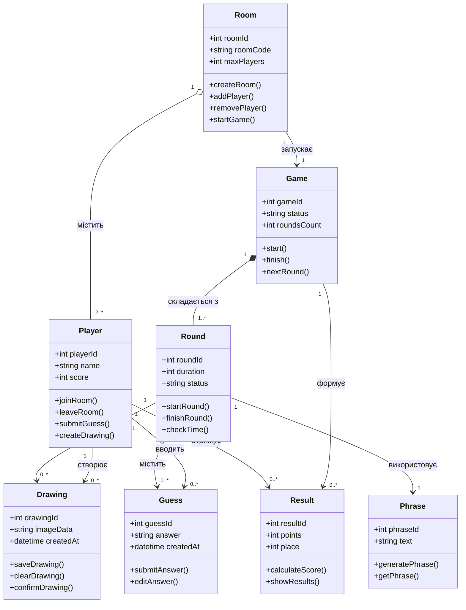

# UML діаграма класів Appellation

## 1. Призначення

Діаграма класів описує основну структуру системи Appellation, її класи, атрибути, методи та зв'язки між ними.

## 2. Основні класи системи

У системі Appellation передбачено такі класи:

1. **Player** — гравець, який бере участь у грі.
2. **Room** — ігрова кімната для учасників.
3. **Game** — керування ігровим процесом.
4. **Round** — окремий раунд гри.
5. **Phrase** — фраза, яку потрібно зобразити.
6. **Drawing** — малюнок, створений гравцем.
7. **Guess** — відповідь гравця під час відгадування.
8. **Result** — результати та набрані бали.

## 3. UML діаграма класів

## 4. Опис зв'язків між класами

- **Room – Player:** одна кімната може містити декількох гравців.
- **Room – Game:** кімната запускає одну гру.
- **Game – Round:** гра складається з одного або декількох раундів.
- **Round – Phrase:** кожен раунд використовує фразу.
- **Round – Drawing:** під час раунду створюються малюнки.
- **Round – Guess:** під час раунду гравці вводять відповіді.
- **Player – Drawing:** гравець може створювати декілька малюнків.
- **Player – Guess:** гравець може вводити декілька відповідей.
- **Player – Result:** гравець отримує результати гри.
- **Game – Result:** гра формує результати учасників.

## 5. Висновок

Було розроблено UML-діаграму класів системи Appellation, яка містить 8 основних класів. Для кожного класу визначено атрибути та методи, а також показано зв'язки між основними елементами системи.
