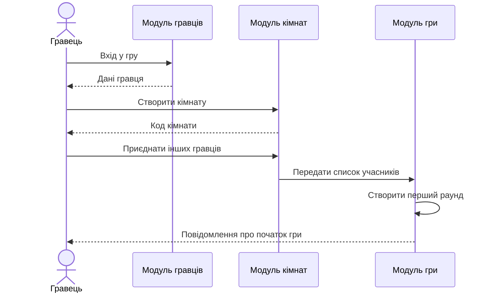
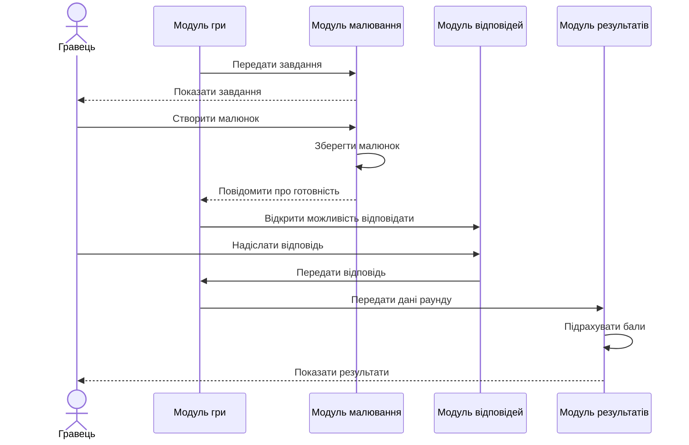

# План інтеграції модулів Appellation

## 1. Мета інтеграції

Мета інтеграції — об'єднати окремі модулі Appellation в одну систему, щоб гравці могли створювати кімнати, брати участь у раундах, малювати, відгадувати слова та переглядати результати.

## 2. Порядок інтеграції модулів

| № | Модуль | Що інтегрується |
|---|---|---|
| 1 | Модуль гравців | Реєстрація гравців та збереження їхніх даних |
| 2 | Модуль кімнат | Створення кімнат і додавання гравців |
| 3 | Модуль гри | Запуск гри та керування раундами |
| 4 | Модуль малювання | Створення та збереження малюнків |
| 5 | Модуль відповідей | Надсилання та перевірка відповідей |
| 6 | Модуль результатів | Підрахунок балів і формування результатів |

Інтеграція виконується поступово. Після підключення кожного модуля перевіряється його взаємодія з уже підключеними модулями.

## 3. Взаємодія модулів у головних сценаріях

### Сценарій 1. Створення кімнати та початок гри

1. Гравець відкриває Appellation.
2. Модуль гравців отримує дані гравця.
3. Модуль кімнат створює нову кімнату.
4. Інші гравці приєднуються до кімнати.
5. Модуль гри отримує список учасників.
6. Гра починається, створюється перший раунд.

### UML Sequence Diagram 1

## 4. Сценарій 2. Малювання, відгадування та отримання результатів

1. Модуль гри визначає гравця, який повинен малювати.
2. Модуль малювання отримує завдання та зберігає малюнок.
3. Інші гравці отримують доступ до малюнка.
4. Модуль відповідей приймає варіанти відповідей.
5. Модуль гри перевіряє завершення раунду.
6. Модуль результатів підраховує бали.
7. Гравці отримують результати раунду.

### UML Sequence Diagram 2

## 5. Список стиків між модулями

| № | Модулі | Що передається | Можливі проблеми |
|---|---|---|---|
| 1 | Гравці — Кімнати | ID гравця, ім'я | Гравець не знайдений |
| 2 | Кімнати — Гра | ID кімнати, список учасників | Порожня кімната або недостатньо гравців |
| 3 | Гра — Малювання | ID раунду, завдання | Неправильне завдання |
| 4 | Малювання — Гра | ID малюнка, статус | Малюнок не збережено |
| 5 | Гра — Відповіді | ID раунду, малюнок | Раунд уже завершений |
| 6 | Відповіді — Результати | Відповіді гравців | Відповідь не отримана |
| 7 | Результати — Гра | Нараховані бали | Неправильний підрахунок |

## 6. Можливі проблеми та способи їх вирішення

| Проблема | Спосіб вирішення |
|---|---|
| Модулі передають неправильні дані | Перевіряти формат і обов'язкові поля |
| Гравець втрачає з'єднання | Дозволити повторне підключення |
| Малюнок не зберігається | Повторити збереження та показати повідомлення про помилку |
| Відповідь надсилається після завершення раунду | Перевіряти статус раунду |
| Бали підраховуються неправильно | Перевіряти алгоритм підрахунку тестами |

## 7. Перевірка інтеграції

Після об'єднання модулів необхідно перевірити:

- створення кімнати та приєднання гравців;
- запуск гри та перехід між раундами;
- створення і збереження малюнків;
- надсилання та обробку відповідей;
- правильність підрахунку балів;
- відображення результатів усім гравцям.

## 8. Висновок

План інтеграції визначає послідовність об'єднання модулів Appellation та їхню взаємодію під час основних сценаріїв гри. Перевірка стиків між модулями допоможе виявити помилки передачі даних і забезпечити правильну роботу застосунку.
