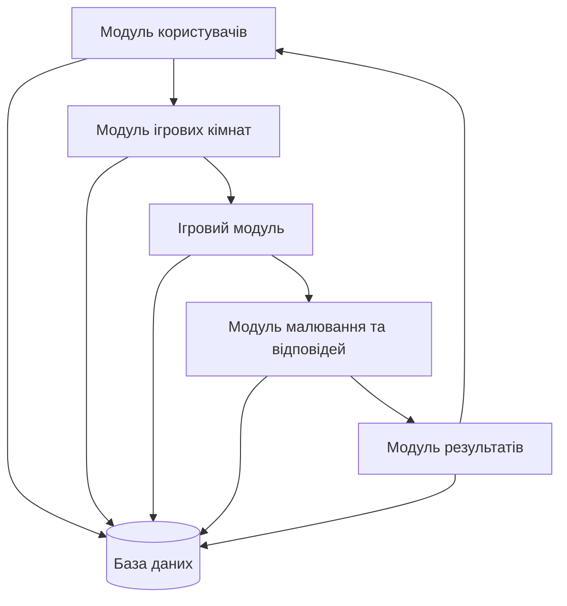

# Модулі системи Appellation

## 1. Загальний опис

Система Appellation складається з п'яти основних модулів, кожен із яких відповідає за окрему частину роботи застосунку. Модулі взаємодіють між собою для забезпечення повноцінного ігрового процесу.

## 2. Основні модулі системи

| Модуль | Відповідальність | Основні операції |
|---|---|---|
| Модуль користувачів | Робота з профілями гравців та їхніми іменами | Створити профіль; змінити ім'я; переглянути профіль; видалити профіль |
| Модуль ігрових кімнат | Створення кімнат і керування учасниками | Створити кімнату; приєднатися до кімнати; переглянути учасників; покинути кімнату |
| Ігровий модуль | Керування грою, раундами та таймером | Запустити гру; розпочати раунд; завершити раунд; перейти до наступного раунду |
| Модуль малювання та відповідей | Створення малюнків і введення відповідей | Створити малюнок; очистити полотно; підтвердити малюнок; надіслати відповідь |
| Модуль результатів | Підрахунок балів та відображення результатів | Підрахувати бали; сформувати рейтинг; переглянути результати; показати історію гри |

## 3. Інтерфейси взаємодії між модулями

| Модуль | Взаємодіє з | Спосіб взаємодії |
|---|---|---|
| Модуль користувачів | Модуль ігрових кімнат | Передає інформацію про гравців |
| Модуль ігрових кімнат | Ігровий модуль | Передає список учасників кімнати |
| Ігровий модуль | Модуль малювання та відповідей | Передає фрази та отримує малюнки й відповіді |
| Модуль малювання та відповідей | Модуль результатів | Передає дані для підрахунку балів |
| Модуль результатів | Модуль користувачів | Передає результати гравців |

## 4. Залежності між модулями

- Модуль ігрових кімнат залежить від модуля користувачів, оскільки використовує дані гравців.
- Ігровий модуль залежить від модуля ігрових кімнат, оскільки отримує список учасників.
- Модуль малювання та відповідей залежить від ігрового модуля, оскільки працює під час ігрових раундів.
- Модуль результатів отримує інформацію від ігрового модуля та модуля малювання й відповідей.
- Усі модулі можуть використовувати спільну базу даних для зберігання інформації.

## 5. Готові компоненти, бібліотеки та сервіси

| Назва | Версія | Призначення |
|---|---|---|
| HTML | HTML5 | Створення структури сторінок |
| CSS | CSS3 | Оформлення інтерфейсу |
| JavaScript | ES2022 | Реалізація логіки застосунку |
| Node.js | 22.x | Виконання серверного JavaScript |
| Express.js | 5.x | Створення серверного API |
| Socket.IO | 4.x | Обмін даними між гравцями в реальному часі |
| PostgreSQL | 17.x | Зберігання даних гри |
| Mermaid | 11.x | Створення діаграм |

## 6. Загальна схема взаємодії модулів

## 7. Висновок

Було визначено п'ять основних модулів системи Appellation, їхні обов'язки, операції та залежності. Також наведено готові технології та бібліотеки, які можна використати під час розробки застосунку. Такий поділ спрощує розробку, тестування та подальше розширення системи.
