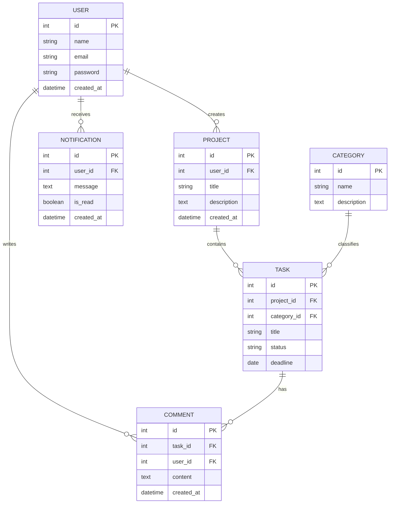

# Модель даних продукту

## 1. Опис

Модель даних визначає основні сутності продукту, їхні атрибути, зв'язки та спосіб зберігання інформації.

## 2. Основні сутності

1. **User** — користувач системи.
2. **Project** — проєкт, створений користувачем.
3. **Task** — завдання всередині проєкту.
4. **Category** — категорія для групування завдань.
5. **Comment** — коментар до завдання.
6. **Notification** — сповіщення користувача.

## 3. Словник даних

### User — користувач

| Поле | Тип | Обов'язкове | Приклад |
|---|---|---|---|
| id | INT | Так | 1 |
| name | VARCHAR(100) | Так | Іван |
| email | VARCHAR(255) | Так | user@gmail.com |
| password | VARCHAR(255) | Так | hashed_password |
| created_at | DATETIME | Так | 2026-11-12 |

### Project — проєкт

| Поле | Тип | Обов'язкове | Приклад |
|---|---|---|---|
| id | INT | Так | 1 |
| user_id | INT | Так | 1 |
| title | VARCHAR(150) | Так | Навчання |
| description | TEXT | Ні | Навчальний проєкт |
| created_at | DATETIME | Так | 2026-11-12 |

### Task — завдання

| Поле | Тип | Обов'язкове | Приклад |
|---|---|---|---|
| id | INT | Так | 1 |
| project_id | INT | Так | 1 |
| category_id | INT | Ні | 2 |
| title | VARCHAR(150) | Так | Виконати роботу |
| status | VARCHAR(30) | Так | In progress |
| deadline | DATE | Ні | 2026-11-20 |

### Category — категорія

| Поле | Тип | Обов'язкове | Приклад |
|---|---|---|---|
| id | INT | Так | 1 |
| name | VARCHAR(100) | Так | Навчання |
| description | TEXT | Ні | Навчальні завдання |

### Comment — коментар

| Поле | Тип | Обов'язкове | Приклад |
|---|---|---|---|
| id | INT | Так | 1 |
| task_id | INT | Так | 1 |
| user_id | INT | Так | 1 |
| content | TEXT | Так | Потрібно завершити роботу |
| created_at | DATETIME | Так | 2026-11-12 |

### Notification — сповіщення

| Поле | Тип | Обов'язкове | Приклад |
|---|---|---|---|
| id | INT | Так | 1 |
| user_id | INT | Так | 1 |
| message | TEXT | Так | Нове завдання |
| is_read | BOOLEAN | Так | false |
| created_at | DATETIME | Так | 2026-11-12 |

## 4. Зв'язки між сутностями

- Один користувач може створити багато проєктів.
- Один проєкт може містити багато завдань.
- Одна категорія може використовуватися для багатьох завдань.
- Одне завдання може мати багато коментарів.
- Один користувач може залишати багато коментарів.
- Один користувач може отримувати багато сповіщень.

## 5. ER-діаграма

## 6. Зберігання даних

Для зберігання даних передбачається використання реляційної бази даних SQLite.

- Дані користувачів зберігаються в таблиці User.
- Проєкти зберігаються в таблиці Project.
- Завдання зберігаються в таблиці Task.
- Категорії зберігаються в таблиці Category.
- Коментарі зберігаються в таблиці Comment.
- Сповіщення зберігаються в таблиці Notification.

Зв'язки між таблицями реалізуються за допомогою первинних та зовнішніх ключів.

Паролі зберігаються лише у вигляді хешів.

## 7. Зовнішні сервіси

На першому етапі продукт не потребує обов'язкових зовнішніх сервісів.

У майбутньому можна додати:

- SMTP — для надсилання електронних листів.
- Хмарне сховище — для зберігання файлів.
- API сервісу авторизації — для входу через сторонні облікові записи.

## 8. Висновок

Розроблена модель даних містить шість основних сутностей та визначає зв'язки між ними. Використання реляційної бази даних дозволяє впорядковано зберігати інформацію та забезпечує цілісність даних.
